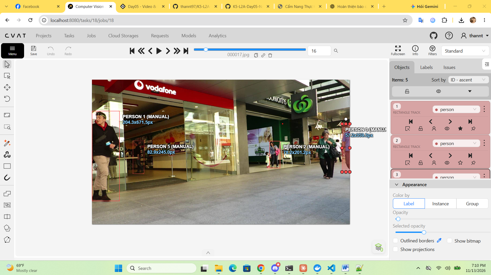

# Báo cáo cá nhân — HoVaTen-MSSV

Đổi tên file theo quy tắc `MSSV_HoTen.md`. Ví dụ: `20241234_NguyenVanAn.md`.

Đoạn video: MOT17-09, 150 frame (frame 1–150), nguồn MOTChallenge, giấy phép CC BY-NC-SA 3.0.

## 0. Thông tin học viên

- Họ tên: Nguyễn Thanh Thản
- MSSV: 2A202603202
- Mã đề (A/B/C): C
- Email: npc12a1@gmail.com
- Link repository: https://github.com/thannt97/K5-L2A-Day05-NguyenThanhThan-2A202603202-MOTTracking
- Giờ bắt đầu: 14: 20
- Giờ kết thúc: 19: 30

## 1. Xem trước đoạn video (CP0)

Ghi **trước khi vẽ**, mỗi người một dòng.

| Mã | Frame xuất hiện | Frame cuối thấy được | Rẽ / dừng / đổi tốc độ ở frame | Bị che ở frame | Ghi chú |
|---|---|---|---|---|---|
| P1 | 0 | 148 | 120 | 0 | vắng ở frame 120-121, outside ở frame 137-148|
| P2 | 0 | 149 | 40 | 91 | gần như đứng yên trong suốt video |
| P3 | 0 | 149 | 59 | 0 | hiện xuyên suốt quá trình |
| P4 | 0 | 149 | 20 | 41 | bị che nhiều gần hết người ở frame 39-59|
| P5 | 38 | 149 | 80| 41 | bị che bởi người áo đen đi qua ở frame 36-56|

## 2. Keyframe và thời gian (CP1, CP4)

Số keyframe lấy từ kết quả `src/check_submission.py`.

| Mã | Số keyframe | Keyframe ở frame | Số frame có mặt | Keyframe / 100 frame | Thời gian (phút) | Chỗ khó |
|---|---|---|---|---|---|---|
| P1 | 53 | [0, 2, 3, 6, 10, 12, 16, 20, 22, 24, 28, 30, 32, 35, 37, 40, 42, 43, 44, 46, 47, 48, 49, 52, 55, 56, 57, 62, 64, 65, 66, 67, 72, 76, 77, 82, 87, 92, 97, 99, 100, 101, 102, 104, 107, 112, 117, 119, 122, 127, 130, 132, 149] | 136 | 39 | 20p | frame 121-123 |
| P2 | 7 | [0, 10, 20, 30, 40, 50, 90] | 107 | 6.5 | 20p| frame 0-10 |
| P3 | 22 | [0, 10, 20, 21, 31, 41, 44, 50, 60, 61, 70, 81, 86, 91, 101, 111, 114, 121, 123, 131, 141, 149] | 150 | 14.7 | 20p | frame 41-59 |
| P4 | 27 | [38, 43, 44, 45, 47, 50, 53, 57, 62, 63, 65, 68, 72, 73, 77, 81, 87, 93, 97, 107, 112, 117, 120, 127, 131, 137, 147] | 112 | 24.1 | 20p | frame 0-10 |
| P5 | 21 | [0, 10, 20, 32, 34, 37, 40, 44, 45, 50, 51, 60, 70, 80, 90, 100, 110, 120, 130, 140, 149] | 150 | 14.0 | 15p | frame 30-41 |
 Tổng: 130 keyframe / 655 frame có mặt = 19.8 keyframe / 100 frame

Keyframe / 100 frame của cả bài = tổng keyframe ÷ tổng số frame có mặt × 100 = 19.8

Bạn đặt keyframe nhiều nhất ở người nào? Vì sao (người đó rẽ, dừng, lại gần camera hay bị che)?

Người đầu tiên vì người này gần hình di chuyển xa, nội suy sai lệch lớn

## 3. Đoạn bị che (CP2)

Người bị che: `P_1`

| Mốc | Frame |
|---|---:|
| Bắt đầu bị che một phần (bật `occluded`) | 137 |
| Mất hẳn (bật `outside`) | 148 |
| Hiện lại (tắt `outside`) | 149 |
| Thấy rõ trở lại (tắt `occluded`) | 0 |

- Thời gian khuất hẳn: 1 frame = 0.33 giây.
- Quyết định: giữ cùng ID / tạo track mới.
- Lý do (trả lời 3 câu: khuất bao lâu so với 60 frame, ngoại hình có khớp, chỗ hiện lại có đúng hướng và tốc độ):
Thời gian khuất: Đối tượng chỉ khuất hẳn 1 frame, ngắn hơn rất nhiều so với ngưỡng 60 frame, nên chưa cần tạo track mới.
Ngoại hình: Nếu người xuất hiện lại ở frame 149 có trang phục, vóc dáng và đặc điểm nhận dạng trùng với P_1 trước khi bị che, có cơ sở giữ nguyên ID.
Hướng và tốc độ: Nếu vị trí xuất hiện lại phù hợp với hướng di chuyển và tốc độ trước khi bị che, có thể xác định đây là cùng một người.

Ảnh chụp màn hình:




## 4. Tự review ID (CP3)

Lượt 1 theo người (đi ngược từ frame 149 về 0 trên CVAT), lượt 2 theo cảnh (nhảy 10 frame). Ít nhất 3 dòng; không có lỗi thì ghi một dòng "đã kiểm hai lượt, không lỗi".
Lượt 1 – Theo người: Đi ngược từ frame 149 về frame 0 trên CVAT, kiểm tra tính liên tục của từng track ID, đặc điểm ngoại hình và vị trí xuất hiện.
Lượt 2 – Theo cảnh: Nhảy mỗi 10 frame, kiểm tra tổng thể các đối tượng trong cảnh, phát hiện trường hợp gán nhầm ID, bỏ sót người, gộp người hoặc bounding box bị lệch.

Loại lỗi dùng đúng một trong 7 mã: `id_switch`, `fragmentation`, `lost`, `merge`, `false_track`, `drift`, `flag`.

| Frame | Mã người | Loại lỗi | Mô tả một câu | Phát hiện ở lượt | Đã sửa? |
|---:|---|---|---|---|---|
| | | | | | |
| | | | | | |
| | | | | | |

Tổng hợp số lỗi theo loại:

| `id_switch` | `fragmentation` | `lost` | `merge` | `false_track` | `drift` | `flag` |
|---:|---:|---:|---:|---:|---:|---:|
| 0 | 0 | 0 | 0 | 0 | 0 | 0 |

Lỗi nào chỉ lượt 2 (theo cảnh) mới thấy, lượt 1 (theo người) không thấy? Vì sao?
Không có lỗi trên

## 5. File xuất và kết quả tự kiểm (CP4)

| Kiểm tra | Kết quả |
|---|---|
| Tên file MOT 1.1 | 1 |
| Tên file CVAT for video 1.1 | 1 |
| Số track ID khác nhau trong `gt/gt.txt` (phải là 5) | có |
| Frame `outside` không có dòng trong `gt.txt` (đúng / sai) | đúng |
| Job đã completed trên CVAT máy cá nhân | 5 |

Dán phần tóm tắt in ra từ `src/check_submission.py`:

```text
Số track ID: 5   |   Tổng số box: 655
  [OK]        Đúng 5 track ID.

  Track | Frame có mặt | Số frame | Đoạn vắng (outside)
      1 |   0–149      |      136 | 120–121, 137–148
      2 |   0–106      |      107 | -
      3 |   0–149      |      150 | -
      4 |   0–149      |      150 | -
      5 |  38–149      |      112 | -

  [CẢNH BÁO]  Track 5: chiều cao box đổi > 30% trong 1 frame ở frame [44, 64, 65]. Kiểm tra box co giật (co box theo phần nhìn thấy?).

=== File CVAT for video 1.1: NguyenThanhThan_cvat_video.zip ===

  Track | Nhãn   | Frame thấy | Keyframe | KF/100 frame | Frame occluded | Lần bật outside
      0 | person |        136 |       53 |         39.0 |             40 |               2
              Track 0: keyframe ở frame [0, 2, 3, 6, 10, 12, 16, 20, 22, 24, 28, 30, 32, 35, 37, 40, 42, 43, 44, 46, 47, 48, 49, 52, 55, 56, 57, 62, 64, 65, 66, 67, 72, 76, 77, 82, 87, 92, 97, 99, 100, 101, 102, 104, 107, 112, 117, 119, 122, 127, 130, 132, 149]
      1 | person |        107 |        7 |          6.5 |             17 |               1
              Track 1: keyframe ở frame [0, 10, 20, 30, 40, 50, 90]
      2 | person |        150 |       22 |         14.7 |             21 |               0
              Track 2: keyframe ở frame [0, 10, 20, 21, 31, 41, 44, 50, 60, 61, 70, 81, 86, 91, 101, 111, 114, 121, 123, 131, 141, 149]
      3 | person |        112 |       27 |         24.1 |             35 |               0
              Track 3: keyframe ở frame [38, 43, 44, 45, 47, 50, 53, 57, 62, 63, 65, 68, 72, 73, 77, 81, 87, 93, 97, 107, 112, 117, 120, 127, 131, 137, 147]
      4 | person |        150 |       21 |         14.0 |             60 |               0
              Track 4: keyframe ở frame [0, 10, 20, 32, 34, 37, 40, 44, 45, 50, 51, 60, 70, 80, 90, 100, 110, 120, 130, 140, 149]

  Tổng: 130 keyframe / 655 frame có mặt = 19.8 keyframe / 100 frame
  [OK]        Đọc được 5 track từ annotations.xml.


## 6. Ba câu kết

1. Nếu được gán lại, bạn sẽ đặt keyframe khác ở đâu? Vì sao?
Nếu được gán nhãn lại, tôi sẽ bổ sung keyframe tại những đoạn đối tượng thay đổi hướng di chuyển, thay đổi tốc độ, bị che khuất một phần hoặc xuất hiện trở lại sau khi bị che. Đặc biệt, tôi sẽ kiểm tra kỹ các đoạn P1 bị che từ frame 137 và mất hẳn tại frame 148, sau đó xuất hiện lại ở frame 149. Việc bổ sung keyframe tại những thời điểm có thay đổi đáng kể giúp bounding box bám sát đối tượng hơn, hạn chế sai lệch khi nội suy giữa các frame.
2. Có chỗ nào bạn không chắc "cùng ID hay ID mới"? Bạn đã quyết định và ghi chú thế nào?
Có. Trường hợp P1 bị che khuất ở cuối video là tình huống cần cân nhắc. P1 bắt đầu bị che một phần tại frame 137, mất hẳn tại frame 148 và xuất hiện lại tại frame 149. Thời gian khuất hẳn chỉ khoảng 1 frame, ngắn hơn nhiều so với ngưỡng 60 frame.

Tôi quyết định giữ nguyên ID P1 thay vì tạo track mới, với điều kiện ngoại hình, vị trí xuất hiện lại, hướng di chuyển và tốc độ phù hợp với quỹ đạo trước đó. Tôi ghi chú đây là trường hợp cần kiểm tra tính liên tục của ID sau che khuất, tránh tạo ID mới không cần thiết.
3. Một lỗi ID trong job của bạn (nếu không còn sót, chọn lỗi đã sửa) có thể làm xe tự lái dự đoán sai chuyển động của người đó như thế nào? Lỗi đó ảnh hưởng MOTA hay IDF1 nhiều hơn?
Ví dụ, nếu một người đi bộ bị gán nhầm sang ID mới sau khi bị che khuất (lỗi fragmentation), hệ thống xe tự lái có thể hiểu nhầm rằng người cũ đã biến mất và một người mới xuất hiện. Điều này làm gián đoạn lịch sử chuyển động, khiến hệ thống khó dự đoán chính xác hướng đi, tốc độ và vị trí tiếp theo của người đi bộ. Xe tự lái có thể đánh giá sai quỹ đạo và phản ứng phanh hoặc tránh người không phù hợp.
Lỗi fragmentation thường ảnh hưởng đến IDF1 nhiều hơn MOTA, vì IDF1 đánh giá mức độ duy trì danh tính đối tượng xuyên suốt các frame. Khi một người bị chia thành nhiều ID, số lần ghép đúng danh tính giảm. MOTA cũng có thể bị ảnh hưởng nếu lỗi kéo theo các trường hợp false positive, false negative hoặc ID switch, nhưng mức độ nhạy trực tiếp với sự đứt đoạn danh tính thường thể hiện rõ hơn ở IDF1.

## Bonus (nếu làm)

### B1 — Hai người đi sát

...

### B2 — So cách đặt keyframe

| Cách đặt | Số keyframe | Frame trôi nhất | Ghi chú |
|---|---:|---:|---|
| Đều mỗi 30 frame | | | |
| Theo chỗ đổi hướng | | | |

...

### B3 — So với tracker có sẵn

| Frame | Mã người | Tracker làm gì | Nhãn của bạn | Giải thích (đoán rồi sửa / ghép IoU / box score thấp / ngoại hình) |
|---:|---|---|---|---|
| | | | | |
| | | | | |

## 7. Tài liệu tham khảo và công cụ AI đã dùng
CVAT – Computer Vision Annotation Tool
Meta AI – Segment Anything Model
