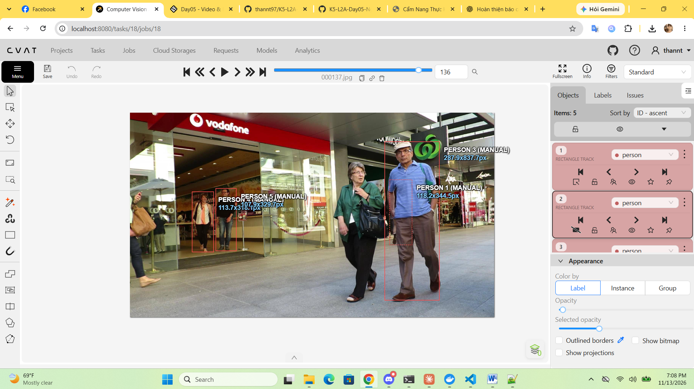
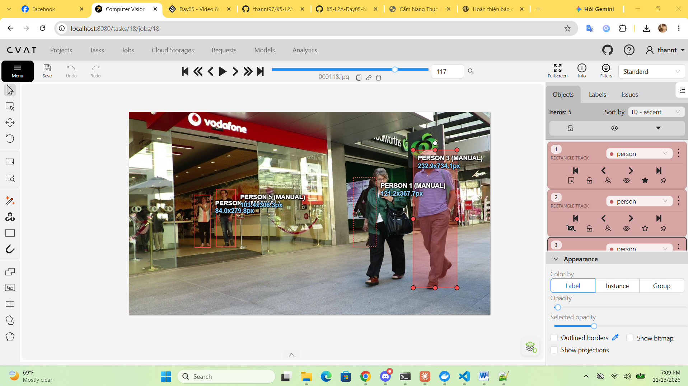

# Báo cáo cá nhân — Nguyễn Thanh Thản – 2A202603202

Đoạn video: MOT17-09, 150 frame (frame 0–149 trên CVAT), nguồn MOTChallenge, giấy phép CC BY-NC-SA 3.0. Mọi số frame trong báo cáo tính theo CVAT (bắt đầu từ 0); trong `gt.txt`, `frame_id` = frame CVAT + 1.

## 0. Thông tin học viên

- Họ tên: Nguyễn Thanh Thản
- MSSV: 2A202603202
- Mã đề (A/B/C): C
- Email: npc12a1@gmail.com
- Link repository: https://github.com/thannt97/K5-L2A-Day05-NguyenThanhThan-2A202603202-MOTTracking
- Giờ bắt đầu: 14:20
- Giờ kết thúc: 19:30

## 1. Xem trước đoạn video (CP0)

| Mã | Frame xuất hiện | Frame cuối thấy được | Rẽ / dừng / đổi tốc độ ở frame | Bị che ở frame | Ghi chú |
|---|---|---|---|---|---|
| P1 | 0 | 149 | 120 | 0–15, 112–138 | Đi gần camera, box lớn; khuất hẳn ở 120–121 và 137–148 (bị người đi ngang che), hiện lại ở 149 |
| P2 | 0 | 106 | 40 | 90–106 | Gần như đứng yên; bị che hẳn từ frame 107 đến hết đoạn |
| P3 | 0 | 149 | 59 | 0–20 | Có mặt suốt 150 frame, lúc đầu bị cắt ở mép phải khung hình |
| P4 | 0 | 149 | 20 | 0–59 | Bị che gần hết người ở frame 39–59 |
| P5 | 38 | 149 | 80 | 38–72 | Xuất hiện ở frame 38; bị người áo đen đi qua che ở khoảng frame 36–56 |

## 2. Keyframe và thời gian (CP1, CP4)

Số keyframe lấy từ kết quả `src/check_submission.py`.

| Mã | Số keyframe | Keyframe ở frame | Số frame có mặt | Keyframe / 100 frame | Thời gian (phút) | Chỗ khó |
|---|---:|---|---:|---:|---:|---|
| P1 | 53 | 0, 2, 3, 6, 10, 12, 16, 20, 22, 24, 28, 30, 32, 35, 37, 40, 42, 43, 44, 46, 47, 48, 49, 52, 55, 56, 57, 62, 64, 65, 66, 67, 72, 76, 77, 82, 87, 92, 97, 99, 100, 101, 102, 104, 107, 112, 117, 119, 122, 127, 130, 132, 149 | 136 | 39.0 | 20 | frame 112–149 (bị che, khuất hẳn hai lần) |
| P2 | 7 | 0, 10, 20, 30, 40, 50, 90 | 107 | 6.5 | 20 | frame 90–107 (bị che rồi khuất hẳn) |
| P3 | 22 | 0, 10, 20, 21, 31, 41, 44, 50, 60, 61, 70, 81, 86, 91, 101, 111, 114, 121, 123, 131, 141, 149 | 150 | 14.7 | 20 | frame 41–59 |
| P4 | 21 | 0, 10, 20, 32, 34, 37, 40, 44, 45, 50, 51, 60, 70, 80, 90, 100, 110, 120, 130, 140, 149 | 150 | 14.0 | 20 | frame 39–59 (bị che gần hết người) |
| P5 | 27 | 38, 43, 44, 45, 47, 50, 53, 57, 62, 63, 65, 68, 72, 73, 77, 81, 87, 93, 97, 107, 112, 117, 120, 127, 131, 137, 147 | 112 | 24.1 | 15 | frame 38–65 (mới xuất hiện đã bị che) |
| **Tổng** | **130** | | **655** | **19.8** | **95** | |

Keyframe / 100 frame của cả bài = 130 ÷ 655 × 100 = **19.8**.

Bạn đặt keyframe nhiều nhất ở người nào? Vì sao?

Nhiều nhất ở **P1** (53 keyframe, 39.0 / 100 frame). P1 đi rất gần camera nên box lớn, mỗi frame dịch chuyển nhiều pixel và đổi kích thước liên tục; P1 còn bị che một phần ở đầu đoạn (0–15) và bị che, khuất hẳn hai lần ở cuối đoạn (112–149). Ở những đoạn này nội suy tuyến tính lệch nhanh nên phải sửa box thường xuyên. Mức 39 / 100 frame vẫn dưới ngưỡng 50 của lớp.

## 3. Đoạn bị che (CP2)

Người bị che: `P1`

| Mốc | Frame |
|---|---:|
| Bắt đầu bị che một phần (bật `occluded`) | 112 |
| Mất hẳn (bật `outside`) | 137 |
| Hiện lại (tắt `outside`) | 149 |
| Thấy rõ trở lại (tắt `occluded`) | Không có — đến frame cuối (149) P1 vẫn bị che một phần nên giữ `occluded` |

Trong đoạn bị che, P1 còn khuất hẳn một lần ngắn ở frame 120–121 (bật `outside` ở 120, tắt ở 122), cũng giữ cùng ID.

- Thời gian khuất hẳn: 12 frame (137–148) ≈ 0,4 giây (30 fps). Lần khuất ngắn 120–121: 2 frame ≈ 0,07 giây.
- Quyết định: **giữ cùng ID**.
- Lý do:
  1. Thời gian khuất: chỉ 12 frame, nhỏ hơn nhiều so với ngưỡng 60 frame của lớp.
  2. Ngoại hình: người hiện lại ở frame 149 có cùng trang phục, dáng người và kích thước box với P1 trước khi bị che.
  3. Hướng và tốc độ: P1 đang đi từ trái sang phải phía sau người đi ngang; chỗ hiện lại ở frame 149 nằm đúng theo hướng và tốc độ đó (box tiếp tục dịch sang phải, chiều cao giữ khoảng 345 px).

Ảnh chụp màn hình:





## 4. Tự review ID (CP3)

- Lượt 1 – theo người: với từng người, đi ngược từ frame 149 về frame 0 trên CVAT, kiểm tra ID có liên tục, box có bám đúng người và cờ `occluded` / `outside` có đúng đoạn.
- Lượt 2 – theo cảnh: nhảy 10 frame mỗi bước, nhìn cả 5 box xem có đổi ID, box thừa / thiếu, hai người bị gộp hay không.

| Frame | Mã người | Loại lỗi | Mô tả một câu | Phát hiện ở lượt | Đã sửa? |
|---:|---|---|---|---|---|
| 38–44 | P5 | `drift` | Khi bị che, box bị co theo phần nhìn thấy (cao 55 px) rồi nhảy lên 97 px ở frame 44, không bao toàn thân ước lượng. | Lượt 1 (và cảnh báo của script) | Chưa — cần kéo box bao toàn thân ước lượng trong đoạn 38–63 rồi xuất lại |
| 63–65 | P5 | `drift` | Khi hết bị che, chiều cao box nhảy 98 → 162 → 227 px trong 2 frame. | Lượt 1 (và cảnh báo của script) | Chưa — sửa cùng lỗi trên |
| 0–149 | P1–P5 | — | Đã kiểm hai lượt: không có `id_switch`, `fragmentation`, `merge`, `false_track`; P1 giữ cùng ID qua hai lần khuất. | Lượt 1 và 2 | — |

Tổng hợp số lỗi theo loại:

| `id_switch` | `fragmentation` | `lost` | `merge` | `false_track` | `drift` | `flag` |
|---:|---:|---:|---:|---:|---:|---:|
| 0 | 0 | 0 | 0 | 0 | 2 | 0 |

Lỗi nào chỉ lượt 2 (theo cảnh) mới thấy, lượt 1 (theo người) không thấy? Vì sao?

Không có lỗi nào chỉ lượt 2 mới thấy. Ngược lại, hai lỗi `drift` của P5 chỉ thấy ở lượt 1 vì chúng xảy ra trong 1–2 frame (44, 64–65); lượt 2 nhảy 10 frame một lần nên dễ bỏ qua.

## 5. File xuất và kết quả tự kiểm (CP4)

| Kiểm tra | Kết quả |
|---|---|
| Tên file MOT 1.1 | `src/exports/NguyenThanhThan_mot.zip` |
| Tên file CVAT for video 1.1 | `src/exports/NguyenThanhThan_cvat_video.zip` |
| Số track ID khác nhau trong `gt/gt.txt` (phải là 5) | 5 |
| Frame `outside` không có dòng trong `gt.txt` (đúng / sai) | Đúng — P1 (ID 1) không có dòng nào ở frame_id 121–122 và 138–149 |
| Job đã completed trên CVAT máy cá nhân | Có |

Phần tóm tắt in ra từ `src/check_submission.py`:

```text
=== File MOT 1.1: NguyenThanhThan_mot.zip ===
  Số track ID: 5   |   Tổng số box: 655
  [OK]        Đúng 5 track ID.

  Track | Frame có mặt | Số frame | Đoạn vắng (outside)
      1 |   0–149      |      136 | 120–121, 137–148
      2 |   0–106      |      107 | -
      3 |   0–149      |      150 | -
      4 |   0–149      |      150 | -
      5 |  38–149      |      112 | -

  [CẢNH BÁO]  Track 5: chiều cao box đổi > 30% trong 1 frame ở frame [44, 64, 65]. Kiểm tra box co giật (co box theo phần nhìn thấy?).

=== File CVAT for video 1.1: NguyenThanhThan_cvat_video.zip ===

  Track | Nhãn   | Frame thấy | Keyframe | KF/100 frame | Frame occluded | Lần bật outside
      0 | person |        136 |       53 |         39.0 |             40 |               2
      1 | person |        107 |        7 |          6.5 |             17 |               1
      2 | person |        150 |       22 |         14.7 |             21 |               0
      3 | person |        112 |       27 |         24.1 |             35 |               0
      4 | person |        150 |       21 |         14.0 |             60 |               0

  Tổng: 130 keyframe / 655 frame có mặt = 19.8 keyframe / 100 frame
  [OK]        Đọc được 5 track từ annotations.xml.

=== Tóm tắt ===
  Lỗi: 0   |   Cảnh báo: 1
```

Đối chiếu track: MOT ID 1 = P1, 2 = P2, 3 = P3, 4 = P4, 5 = P5 (CVAT track 0 = P1, 1 = P2, 2 = P3, 3 = P5, 4 = P4). Cảnh báo của Track 5 (P5) chính là hai lỗi `drift` đã ghi ở mục 4.

## 6. Ba câu kết

1. **Nếu được gán lại, bạn sẽ đặt keyframe khác ở đâu? Vì sao?**
   P2 đang đặt keyframe đều mỗi 10 frame (0–50) rồi nhảy tới 90; tôi sẽ đặt lại theo chỗ P2 bắt đầu dừng / đi tiếp và thêm keyframe ngay trước khi P2 bị che (khoảng frame 88–90) và ngay trước frame 107. Với P5, tôi sẽ giữ box bao toàn thân ước lượng trong đoạn bị che 38–63 thay vì co theo phần nhìn thấy, để không có bước nhảy chiều cao ở frame 44 và 64–65. Với P1, tôi sẽ bớt keyframe ở đoạn đi thẳng đều (ví dụ 42–49 đang có 6 keyframe liền nhau) và dồn keyframe vào quanh hai lần khuất (119–122, 136–137, 149).

2. **Có chỗ nào bạn không chắc "cùng ID hay ID mới"? Bạn đã quyết định và ghi chú thế nào?**
   Có, là đoạn P1 khuất hẳn ở frame 137–148 rồi hiện lại ở frame 149 (và lần khuất ngắn 120–121). Thời gian khuất 12 frame, nhỏ hơn nhiều so với ngưỡng 60 frame; người hiện lại có cùng ngoại hình, kích thước box và đúng hướng đi của P1, nên tôi giữ nguyên ID P1, tắt `outside` ở frame 149 và đặt keyframe mới tại đó. Quyết định này được ghi ở mục 3.

3. **Một lỗi ID trong job của bạn có thể làm xe tự lái dự đoán sai chuyển động của người đó như thế nào? Lỗi đó ảnh hưởng MOTA hay IDF1 nhiều hơn?**
   Ví dụ, nếu P1 bị gán sang ID mới sau khi khuất ở frame 137–148 (lỗi `fragmentation`), hệ thống sẽ hiểu là người cũ biến mất và một người mới xuất hiện ở frame 149. Lịch sử chuyển động bị cắt, nên hệ thống không còn vận tốc và hướng đi trước đó của P1 để dự đoán vị trí tiếp theo; xe có thể đánh giá sai quỹ đạo người đi bộ và phanh hoặc tránh không kịp thời.
   Lỗi này ảnh hưởng IDF1 nhiều hơn MOTA. IDF1 đo tỉ lệ frame được gán đúng danh tính trên toàn bộ track, nên khi một người bị tách làm hai ID, phần sau lỗi đều bị tính sai danh tính. MOTA chỉ cộng thêm một lần ID switch tại điểm đứt, nên thay đổi rất ít.

## Bonus

Không làm.

## 7. Tài liệu tham khảo và công cụ AI đã dùng

- CVAT – Computer Vision Annotation Tool
- Meta AI – Segment Anything Model
- Tài liệu của lab: `docs/GUIDELINE.md`, `docs/MOT_FORMAT.md`, `CHECKPOINTS.md`
- Claude (Anthropic) – hỗ trợ rà soát và chỉnh sửa trình bày báo cáo
